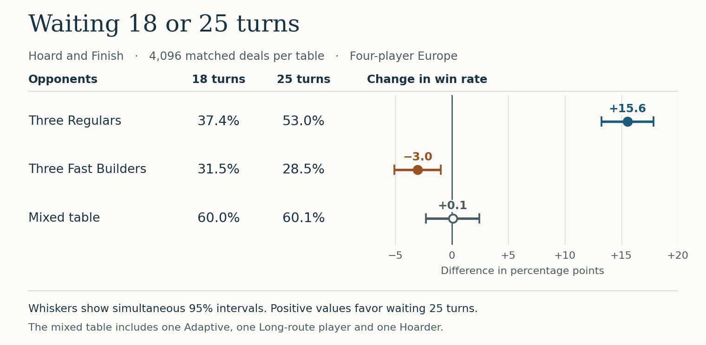

# Ticket_To__Ride_Europe_Companion

Python route planning and seeded strategy tournaments for classic **Ticket to Ride: Europe**.



Explore the [paired wait comparison](docs/europe-wait-comparison.md) or the [six-strategy pilot heatmap](docs/europe-tournament.md#four-player-results).

**Watch a game:** open [the strategy replay](docs/strategy-replay.html) in a browser (download the HTML if viewing on GitHub). It starts at the first move where the 18- and 25-turn policies differ. Switch the wait to see the same deal and seat at the same move; choose **Opening deal** to watch from the start. During play the scoreboard shows track points; at the end it includes tickets, stations and the express bonus.

Choose **Jump to → Next face-down draw** to inspect a blind pick. Each pick shows the face-up market before the choice, the card taken, and whether it came from the market or the deck.

Each pick shows the acting player's hand before that pick. Track claims and stations show the cards paid and the hand left over. The board follows the acting player's destination tickets. Select a ticket to isolate its two cities, or use **Tickets on map** to follow a particular player. Expand **All four hands and tickets** to inspect the whole table. [Read the article and play online](https://devmarkuslejon.github.io/projects/ticket-to-ride/).

Dotted tracks show the ticket paths the selected player used at their last decision. Choose **Jump to → Next blocked plan** to pin an affected ticket. The × marks the exact track another player took. **See their next decision** advances to the affected player's turn, when the bot can choose another route. Players pursuing long tracks or taking their opening draws have no active ticket route.

The viewer includes the first matched deal at each tournament table. To watch another, run `python -m experiments.replay --deal 7 --out replay-7.html` (deal indices 0–4095). Each replay is a single file that works offline.

## Run the strategy experiment

From the repository root, using Python 3.10 or newer, play 20 four-player games with a Hoarder against three Regulars.

```bash
python -m ttr_europe.tournament --candidate hoarder --games 20 --seed 10000
```

To rebuild both figures from the saved experiment CSVs, install Matplotlib and run `python -m experiments.plot_tournaments`. The simulations themselves use the Python standard library.

## What this implements

- **BoardGraph** (immutable): cities, routes, and adjacency lists loaded from JSON.
- **GameState** (mutable): claimed route ownership overlay for path calculations.
- **Algorithms**:
  - Dijkstra shortest path with pluggable cost functions.
  - Default build cost (`route.length`).
  - Risk-adjusted cost (adds tunnel/ferry premiums).

This architecture supports route planning, blocking-aware pathing, and simulation workflows.

## Data model

Each route captures:

- `route_id`
- `city_a` / `city_b`
- `length`
- `color`
- `is_tunnel`
- `ferry_locomotives_required`
- `parallel_group` (for double-routes)

Sample board file: `data/europe_sample_board.json`.

## Quick start

```python
from ttr_europe import BoardGraph, GameState, shortest_path, risk_adjusted_cost

board = BoardGraph.from_json("data/europe_sample_board.json")
state = GameState(board=board)

# Opponent claims a route.
state.claim_route("bruxelles_amsterdam", player_id="opponent")

path, cost = shortest_path(
    state,
    start_city="paris",
    target_city="amsterdam",
    player_id="me",
)
print(path, cost)

path_risk, cost_risk = shortest_path(
    state,
    start_city="paris",
    target_city="zurich",
    player_id="me",
    cost_fn=risk_adjusted_cost,
)
print(path_risk, cost_risk)
```

## Test

```bash
python -m pytest -q
```

## Run as CLI

You can now run route queries directly:

```bash
python -m ttr_europe --start paris --target amsterdam
```

Include train-color breakdown for the shortest path:

```bash
python -m ttr_europe --start paris --target amsterdam --breakdown
```

Example with blocked route and risk-adjusted cost:

```bash
python -m ttr_europe \
  --start paris \
  --target zurich \
  --player me \
  --claim bruxelles_amsterdam:opponent \
  --cost risk
```

## Convert CSV data to JSON

To convert `cities.csv`, `routes.csv`, and `destinations.csv` into JSON files:

```bash
python -m ttr_europe.csv_converter
```

This writes:

- `data/europe_board_from_csv.json` (compatible with `BoardGraph.from_json`)
- `data/europe_destination_tickets_from_csv.json`
- `data/europe_sample_board_from_destinations.json` (sample-board-format template)
- `data/europe_sample_board_from_routes.json` (sample-board-format template from `routes.csv`)

Use `europe_board_from_csv.json` for the full board and `europe_destination_tickets_from_csv.json` for the deck. Each row of `routes.csv` specifies the color and cost of one physical track. Double tracks have two rows. `destinations.csv` identifies the six long tickets explicitly.

`europe_sample_board_from_destinations.json` is a legacy conversion example. It treats ticket endpoints as edges and maps points to lengths, which produces fictitious routes. The tournament loads the two audited files above. The converter still accepts older route CSVs with a `Colored` flag and marks their unknown colors in the routes-based sample.

## Render board map

You can render the coordinate-based board JSON as an SVG map:

```bash
python -m ttr_europe.map_renderer --board data/europe_board_from_csv.json --out data/europe_board_map.svg
```

Open `data/europe_board_map.svg` in your browser.
